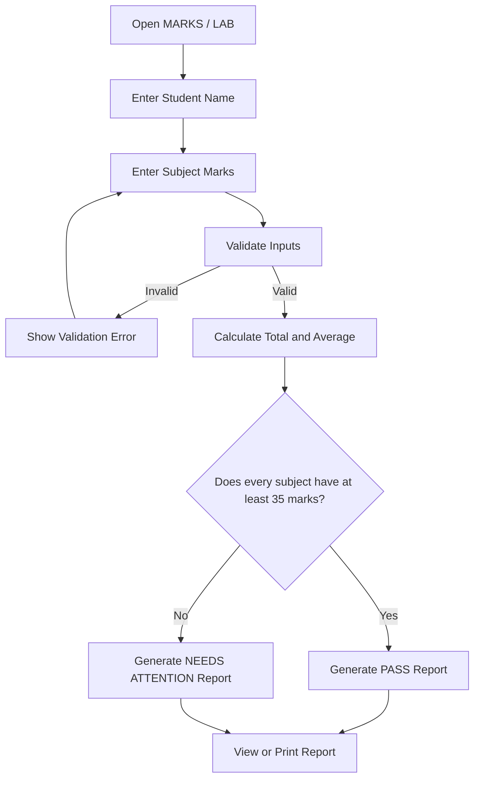

# MARKS / LAB — Result Studio

A Flask-based student marks calculator designed to turn subject scores into a clear, easy-to-understand result report.

Enter marks, view live calculations, check subject-wise performance, and generate a print-friendly result report — all through a custom-designed responsive interface.

**Three subjects. One clear picture.**

---

## Preview

### 01. Marks Entry

Enter the student's name and marks for Python, C Programming, and Data Structures & Algorithms. The application updates the total and average as marks are entered.


### 02. Passing Result

When every subject meets the minimum pass mark, the application generates a PASS report with the overall percentage, total score, and subject-wise breakdown.


### 03. Result Needs Attention

When even one subject is below the minimum pass mark, the report highlights that subject and displays the NEEDS ATTENTION status.


---

## Features

- **Student Details:** Enter the student's name before generating a report.
- **Three Subject Inputs:** Calculate marks for Python, C Programming, and Data Structures & Algorithms.
- **Live Calculations:** View the total and average while entering marks.
- **Input Validation:** Check for missing values, invalid whole numbers, and marks outside the permitted range.
- **Subject-wise Performance:** View individual marks and pass status for each subject.
- **Overall Result:** Generate a report containing total marks, percentage, average, and final status.
- **Visual Score Indicators:** View the overall score ring and subject progress bars.
- **Print Report:** Use the browser's print functionality to print the generated result.
- **Responsive Interface:** Access the application on desktop and mobile screens.
- **No Database Required:** Student information is processed for the calculation and is not saved by the application.

## Result Calculation

| Parameter | Rule |
|---|---|
| Subjects | Python, C Programming, DSA |
| Maximum marks per subject | 100 |
| Maximum total marks | 300 |
| Minimum passing marks | 35 per subject |
| Total | Sum of all three subject marks |
| Average | Total / 3 |
| Overall percentage | (Total / 300) × 100 |

**Passing condition:** A student receives PASS only when all three subjects have at least 35 marks.

A high overall average does not compensate for a subject below the minimum threshold. In that case, the application displays NEEDS ATTENTION.

## Application Workflow



## Tech Stack

| Technology | Purpose |
|---|---|
| Python | Backend programming and calculations |
| Flask | Web application framework |
| HTML5 | Application structure |
| CSS3 | Styling and responsive interface |
| JavaScript | Live calculations and client-side validation |

## Getting Started

### Prerequisites

- Python 3.10 or newer
- pip package manager
- A modern web browser

### 1. Clone the Repository

```bash
git clone https://github.com/sivakumar9867/marks-calculator.git
```

### 2. Navigate to the Project Folder

```bash
cd marks-calculator
```

### 3. Create a Virtual Environment

**Windows:**

```powershell
py -m venv .venv
.venv\Scripts\activate
```

**macOS / Linux:**

```bash
python3 -m venv .venv
source .venv/bin/activate
```

### 4. Install Dependencies

```bash
pip install -r requirements.txt
```

### 5. Run the Application

```bash
python app.py
```

### 6. Open in Browser

Visit:

```text
http://127.0.0.1:5000
```

## Project Structure

```text
marks-calculator/
│
├── app.py
├── requirements.txt
├── index.html                 # Earlier standalone version
│
├── templates/
│   └── index.html             # Flask application template
│
├── static/
│   ├── app.js
│   └── style.css
│
├── assets/
│   └── screenshots/
│       ├── marks-lab-home.jpg
│       ├── marks-lab-pass-report.jpg
│       └── marks-lab-attention-report.jpg
│
├── .gitignore
└── README.md
```

## Learning Outcomes

Through this project, I explored and practised:

- Building a web application using Python and Flask.
- Handling HTML form submissions.
- Implementing input validation and error handling.
- Performing calculations and conditional result processing.
- Using JavaScript to update values dynamically.
- Designing responsive user interfaces using CSS.
- Generating structured result reports with print support.

## Future Improvements

- Support for custom subjects and configurable pass marks.
- PDF report export.
- Optional student result storage.
- Multiple student records and academic sessions.
- Additional grading and performance analysis.

## About the Project

MARKS / LAB — Result Studio is an educational project built to simplify basic student marks calculation and result reporting.

Generated reports are based only on the values entered by the user. They are not official academic marksheets.

---

**Built with Python and Flask.**
