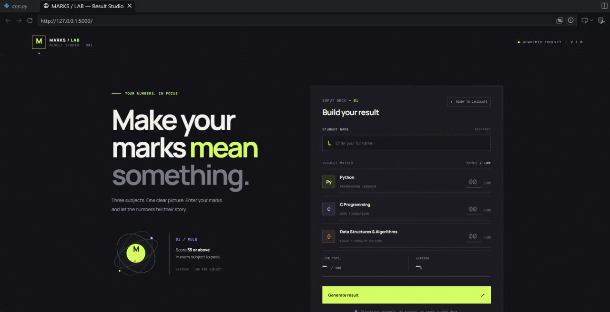
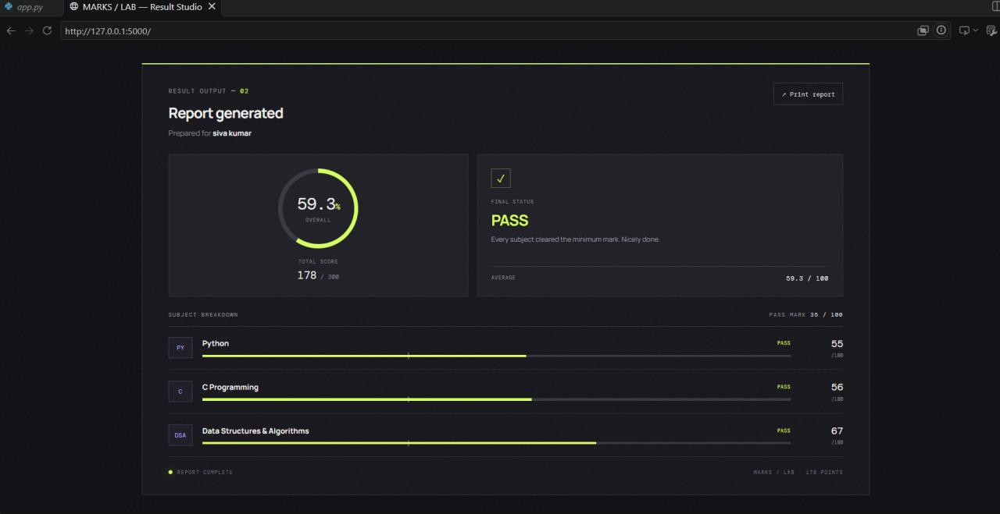
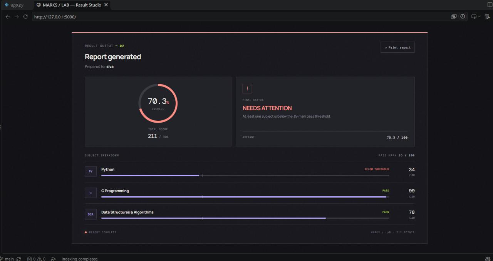

# MARKS / LAB — Result Studio

A Flask-based student marks calculator designed to turn subject scores into a clear, easy-to-understand result report.

Enter marks, view live calculations, check subject-wise performance, and generate a print-friendly result report — all through a custom-designed responsive interface.

**Three subjects. One clear picture.**

---

## Preview

### 01. Marks Entry

Enter the student's name and marks for Python, C Programming, and Data Structures & Algorithms. The application updates the total and average as marks are entered.



### 02. Passing Result

When every subject meets the minimum pass mark, the application generates a PASS report with the overall percentage, total score, and subject-wise breakdown.



### 03. Result Needs Attention

When even one subject is below the minimum pass mark, the report highlights that subject and displays the NEEDS ATTENTION status.



---

## Features

- **Student Details:** Enter the student's name before generating a report.
- **Three Subject Inputs:** Calculate marks for Python, C Programming, and Data Structures & Algorithms.
- **Live Calculations:** View the total and average while entering marks.
- **Input Validation:** Check for missing values, invalid whole numbers, and marks outside the permitted range.
- **Subject-wise Performance:** View individual marks and pass status for each subject.
- **Overall Result:** Generate a report containing total marks, percentage, average, and final status.
- **Visual Score Indicators:** View the overall score ring and subject progress bars.
- **Print Report:** Use the browser's print functionality to print the generated result.
- **Responsive Interface:** Access the application on desktop and mobile screens.
- **No Database Required:** Student information is processed for the calculation and is not saved by the application.

## Result Calculation

The application uses the following rules:

| Parameter | Rule |
|---|---|
| Subjects | Python, C Programming, DSA |
| Maximum marks per subject | 100 |
| Maximum total marks | 300 |
| Minimum passing marks | 35 per subject |
| Total | Sum of all three subject marks |
| Average | Total / 3 |
| Overall percentage | (Total / 300) × 100 |

**Passing condition:** A student receives PASS only when all three subjects have at least 35 marks.

A high overall average does not compensate for a subject below the minimum threshold. In that case, the application displays NEEDS ATTENTION.

## Application Workflow

```mermaid
flowchart TD
    A[Open MARKS / LAB] --> B[Enter Student Name]
    B --> C[Enter Subject Marks]
    C --> D[Validate Inputs]
    D -->|Invalid| E[Show Validation Error]
    E --> C
    D -->|Valid| F[Calculate Total and Average]
    F --> G{All Subjects >= 35?}
    G -->|Yes| H[Generate PASS Report]
    G -->|No| I[Generate
